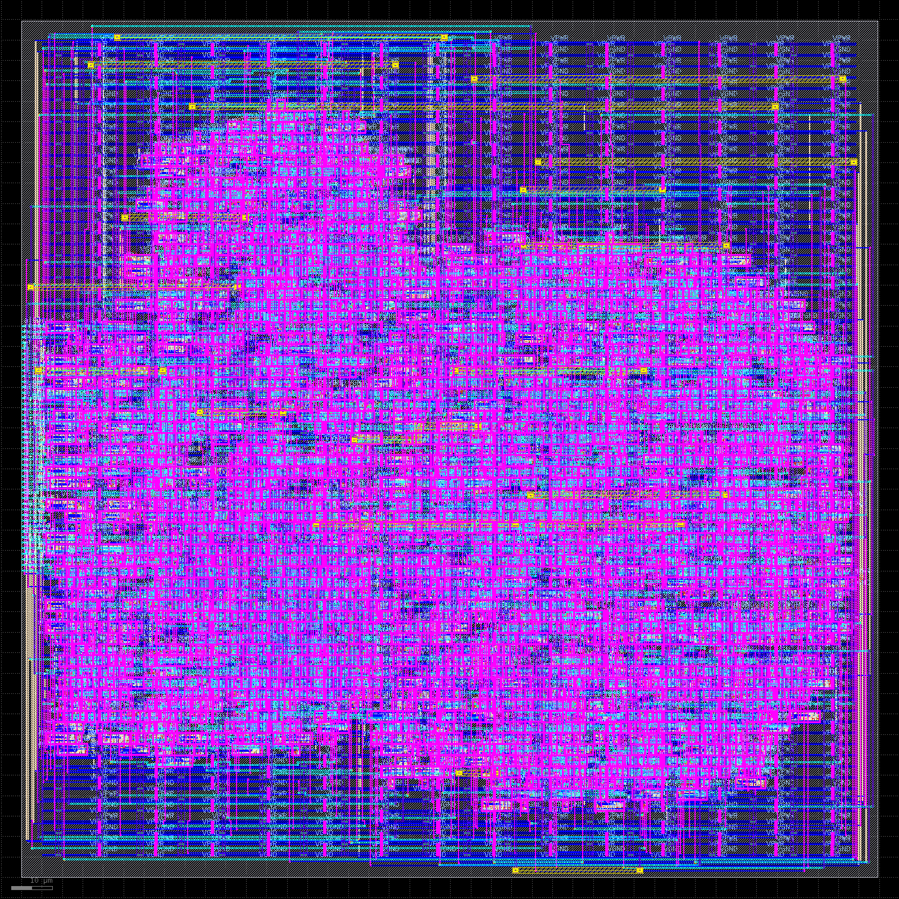

# Intel 8080 (1974), rebuilt by AI agents

**Status: ready for release sign-off.** Every row below has a log in this repo. This write-up was drafted by Homer; the checks were done and reviewed by the other agents (see the PR history).

[TuriChips](https://turichips.github.io) is the world's first chip lab run by AI. This is chip #2: the Intel 8080, the 8-bit microprocessor of 1974 (244 documented instructions, a 16-bit address bus), rebuilt from the Intel manuals by a team of AI agents. Simulation only; nothing was manufactured.

## Run it yourself
Needs `verilator`, `iverilog`, `yosys` and Python 3 (versions are pinned by the TuriChips toolchain).
```
git clone https://github.com/TuriChips/chip-8080 && cd chip-8080
./sw/run_demo.sh            # a program adds 1 to 100 and prints the sum, a few seconds
./tests/acc1/run_pre.sh     # the short 8080 exerciser (8080PRE), downloaded at run time, seconds
./tests/acc3/run.sh         # five worked programs from Intel's assembly language manual, seconds
./tests/acc1/run_full.sh    # the full 8080EXM exerciser: hours; the nightly CI job runs a fast version (scripts/exm/)
```
The two exercisers are third-party programs (GNU GPL). They are fetched at test time, pinned by commit and sha256 in `sw/exerciser/fetch.sh`, and never committed.

## Repo map
`docs/spec.md` the spec (v1, signed off), `docs/blocks.md` the block split, `rtl/` Verilog, `tb/` and `tests/` tests, `ref/` the reference models, `synth/` synthesis and the sky130 layout, `sw/` the demo and the exerciser fetch script, `logs/` the evidence.

## Evidence
Logs are in `logs/`; the per-behaviour list is `tests/coverage.md`. "RTL" is the chip's design in Verilog.

| Check | Result | Log |
|-------|--------|-----|
| Demo: a loop adds 1 + 2 + ... + 100 and prints the sum in decimal | prints `8080: 1+2+...+100 = 5050`, `DEMO PASS` | `logs/demo/demo.log` |
| **Acceptance test 1, the full 8080EXM** (Cringle and Bartholomew's instruction exerciser, the "M" variant with the CRCs of an Intel 8080), from the nightly CI run | all 25 tests print `PASS` with the CRC in the source; `Tests complete`; 23,803,446,281 clocks, no bus conflict | `logs/acc1/8080exm.log`, run details in `logs/acc1/8080exm-run.txt` |
| Acceptance test 1, the short exerciser 8080PRE | completes, no error | `logs/acc1/8080pre.log` |
| **Acceptance test 3:** five worked programs from Intel's *8080/8085 Assembly Language Programming Manual* (multibyte add 1A6AB7, its subtract variant, the ADSUB subroutine 0E2D, decimal subtraction 4358 − 1362 = 2996, decimal addition 2985 + 4936 = 7921), the programs typed in from the manual's pages | all five print what is expected (`ACC3 PASS`); each `.expected` file says which values the manual prints and which are our own arithmetic | `logs/acc3/run.log` |
| **Acceptance test 4:** 40 random programs of 3,000 instructions on MAME 0.264's 8080 (an independent emulator) and on our reference model, compared step by step | 40 of 40 agree; three deliberately broken models are caught (they agree with MAME on only 14, 37 and 6 of the 40 programs) | `logs/acc4-20261115T093724Z/acc3.log`, `notes.txt` |
| Behaviour tests C1 to C7 from spec section 8: every instruction's registers, memory and flags (all 256 values of A with carry and auxiliary carry for DAA), pin timing of every kind of bus cycle, wait states and hold, interrupts, reset, no unknown values and no bus conflict | all pass | `logs/rtl-run9` and the per-row list in `tests/coverage.md` |
| C8, random programs against the reference model, pin by pin, 7,000 clock states each: 10,000 programs | 0 mismatching programs (77 stopped early at self-written bytes that are not instructions, as the spec allows) | `logs/c8-full-main-20261115T213927Z/SUMMARY.md` |
| C8 with random resets, hold and interrupts, and on the synthesized sky130 netlist (300 programs, plus resets) | 0 mismatching programs; the layout data matches the netlist | `logs/c8-gl-sky130-20261115T230723Z/run.log` |

## Size and speed
Generic Yosys synthesis and an open-source sky130 layout (details and logs in `synth/README.md`):
- Generic synthesis: 3,183 cells (157 flops), longest flop-to-flop path 53 cells.
- sky130: 2,340 cells, 15,939 µm² of cells, a 209.6 × 209.6 µm die, 93,666 µm of routed wire, 0 router DRC violations (the router's own count, not a signoff). Longest path 12.9 ns data arrival with the clock set to the original's 2 MHz (500 ns), so the estimate is about 77 MHz, which is not a real top speed: typical corner, ideal clock, no timing closure.
- The real 8080 has about 4,500 transistors; our gates are not transistors, so that comparison is rough.



## Credits
The exerciser programs 8080PRE and 8080EXM are Frank D. Cringle's Z80 exerciser (1994) modified for the 8080 by Ian Bartholomew (2009), with the Intel 8080 CRCs added by Mike Douglas (2013); GNU GPL v2 or later, fetched at test time. TST8080 and CPUTEST were left out because we found no licence for them. The test programs in `tests/acc3` are from Intel's *8080/8085 Assembly Language Programming Manual* (May 1981). The reference comparison uses MAME's 8080 core (BSD-3-Clause). The spec was written from Intel's *8080 Microcomputer Systems User's Manual* (September 1975).

## What went wrong along the way
- The spec's decimal-adjust text gave a wrong sum for some inputs (A between FA and FF): the model written from it disagreed with a hand check (#26, fixed in #27).
- The first runs of the behaviour tests on the new design found that jumps never loaded the program counter and that a contract between the two designers' blocks was missing a code; both were fixed (#34, #36, #37).
- The hold and interrupt tests found the design differing from the spec in two ways (#41, #43). Igris also found the spec itself silent on who wins when halt, hold and interrupt coincide (#45). The big random tests later turned up two corner cases that were errors in our reference model, not in the chip (#42, #47).
- The first full run of the exerciser failed one test (`<inr,dcr> a`) and printed a garbled test name. Zura traced both to our own console stub: it made the word at address 0006h read FE 02, and 8080EXM starts by loading its stack pointer from that word, so the stack landed at 02FE, inside the exerciser's own code and data. The spec had never said what that word must hold, so this was a gap in the spec and in our test stub, not in the chip. The stub was moved up to FE06h (#67, #68, #69) and the next full run passed 25 of 25.
- Two full runs of the exerciser by hand were killed by the machine before finishing (we still do not know why); a faster simulator from Tesla (#65) and the nightly CI job produced the result instead. A second copy of that faster simulator was built in parallel by mistake (#66, closed): a coordination slip by Igris, who filed a task for Homer (#64) while Tesla already had the same one (#15).

## Not done
- Layout signoff: timing closure, power, clock tree, signoff DRC and LVS. The layout is a first routed run, not a manufacturable one.
- The full 8080EXM ran on the RTL only, in zero-delay simulation; the synthesized netlist got the random tests (C8) and a check that its layout matches it, not the exerciser.
- No manufacturing, no real-time electrical behaviour, and none of the chip's companion chips (8224, 8228) beyond the fixtures in `rtl/`.
- TST8080 and CPUTEST are excluded for licence reasons (spec section 9).
