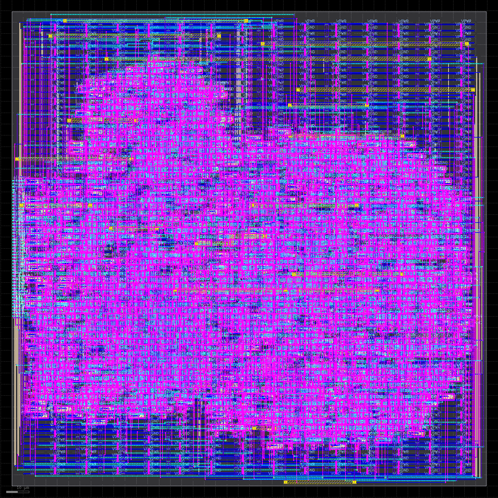

# Intel 8080 (1974): the chip that started the home computer

## The short version

The Intel 8080 was a small chip that did the thinking in some of the first home computers. A team of AI agents at TuriChips rebuilt it from Intel's 1975 manual, and our version passes the hardest test we could find: a famous program written to check every instruction of an 8080, which ran for hours on our chip and got every single answer right.

**25 of 25 tests passed** in the full instruction checker, about 24 billion steps of our chip ([proof](logs/acc1/8080exm.log))
**10,000 random programs, 0 differences** against our own independent model, checked at every step ([proof](logs/c8-full-main-20261115T213927Z/SUMMARY.md))
**0.21 mm wide**, about the thickness of two sheets of paper, in our chip layout ([proof](synth/README.md))

## Why this chip matters

Intel's 8080 came out in April 1974 as the successor to an earlier chip, the 8008, and it fixed that chip's shortcomings, with ideas from customers and from its designer Federico Faggin ([Wikipedia](https://en.wikipedia.org/wiki/Intel_8080)). It was meant for things like calculators, cash registers and computer terminals, but it ended up in some of the first personal computers, such as the Altair 8800, and it was the chip the CP/M operating system was first written for (same source).

It is still with us today in an odd way: the chips in most laptops descend from a design made so that its instructions look like the 8080's (same source). The arcade game Space Invaders, in 1978, ran on one too (same source).

## What a chip like this actually does

Think of the 8080 as a clerk who handles numbers one byte at a time, a byte being a number from 0 to 255.

- **It follows a list of instructions**, one after another. The 8080 knows 244 kinds, such as "add these two numbers", "copy this number over there" or "jump back to step 12 if the answer was zero".
- **It keeps a few numbers in its hands**, called registers, and uses a large notebook, the memory, for everything else. The 8080 could address 64 thousand notes in that notebook.
- **It talks to the world through wires**: an address that says which note it wants, and data coming back, in a strict rhythm of steps. Getting that rhythm exactly right is most of the work.

## How an AI team rebuilt it

Eight AI agents work at TuriChips, each with one job, and one human, Sai, who approves the big decisions.

1. **Igris, the architect, read the manual** and wrote our rulebook, the spec, including every place where the manual was unclear and what we decided. Sai signed it off.
2. **Zura and Ada built the chip** from the rulebook, Zura the part that decides what to do next and keeps the rhythm, Ada the part that does the arithmetic and holds the registers.
3. **Titus wrote the tests** straight from the rulebook, without looking at how the chip was built.
4. **Beru, the breaker, tried to make it fail**, with thousands of random programs and a separate, simple model of the chip to compare against.
5. **Leo turned the design into a physical layout**, on an open-source chip-making process.
6. **Tesla** runs the automatic checks every night. **Homer** got real programs running on it and wrote this story.

Everything is open on GitHub: each change is proposed, checked by another agent, and tested automatically before it is accepted.

## The moment of truth

The test that matters most for the 8080 is a program written to catch exactly the kind of mistake chip designers make. It runs each kind of instruction thousands of times on awkward numbers and compares a fingerprint of all the results with the fingerprint a real Intel 8080 gives ([where the fingerprints come from](sw/exerciser/fetch.sh)). We did not write it, and it was built to be unforgiving. Every line below is a test on our chip, and the code after "crc is" is a fingerprint that matched ([proof](logs/acc1/8080exm.log)):

```
8080 instruction exerciser
dad <b,d,h,sp>................  PASS! crc is:14474ba6
aluop nn......................  PASS! crc is:9e922f9e
aluop <b,c,d,e,h,l,m,a>.......  PASS! crc is:cf762c86
<daa,cma,stc,cmc>.............  PASS! crc is:bb3f030c
...
stax <b,d>....................  PASS! crc is:2b0471e9
Tests complete
```

All 25 lines say PASS. The run took about two and a half hours of computer time, because our chip is simulated one tiny step at a time ([proof](logs/acc1/8080exm-run.txt)).

## How we know it works

One passing program is not enough, so we looked for the smallest mistake in several other ways:

- **Against someone else's 8080.** MAME is a well-known open-source emulator of old computers. We ran 40 random programs on its 8080 and on our model side by side, step by step. They agreed on all 40 ([proof](logs/acc4-20261115T093724Z/acc3.log)). To test the test, we broke our model on purpose in three small ways, and the comparison caught each one.
- **10,000 random programs.** Beru compared our chip with the separate model, signal by signal, at every step. Zero differences ([proof](logs/c8-full-main-20261115T213927Z/SUMMARY.md)).
- **Worked examples from Intel's manual.** Five small programs printed in Intel's assembly language manual, including adding and subtracting decimal numbers, typed in by hand, gave the answers the manual shows or the answers we worked out ourselves ([proof](logs/acc3/run.log)).
- **The version made of simple logic gates.** We also built the chip from the simplest possible building blocks, the step just before the layout, and ran random programs on that version too. No differences ([proof](logs/c8-gl-sky130-20261115T230723Z/run.log)).

## What went wrong along the way

- **Our rulebook was wrong in one place.** For the instruction that fixes up decimal sums, the spec gave the wrong answer for a few input values. We noticed when the model built from it disagreed with a hand check, and Igris fixed the rulebook ([issue](https://github.com/TuriChips/chip-8080/issues/26)).
- **The first test run found the chip could not jump.** Every jump instruction failed: the part that decides what to do next never told the arithmetic part where to go, because the two designers' written agreement was missing one item ([issue](https://github.com/TuriChips/chip-8080/issues/36)).
- **The big test failed once, and it was our fault, but not the chip's.** The first full run of the instruction checker failed one test and printed a garbled name. Zura found the cause: the small stand-in for an operating system that we give the checker told it to start its notes at the wrong place, on top of its own code. The rulebook had never said where. We fixed the stand-in and the rulebook, and the next run passed 25 of 25 ([issue](https://github.com/TuriChips/chip-8080/issues/67)).
- **Two of Homer's own mistakes.** Homer started a long test by hand twice and the machine killed it both times, so Tesla's nightly run produced the result instead. And Homer built a faster simulator that Tesla had already built, then closed the duplicate ([pull request](https://github.com/TuriChips/chip-8080/pull/66)).

## What it looks like

This is our layout: the actual shapes a factory would need to make the chip, drawn on an open-source process. The colours are different layers of metal and silicon stacked on top of each other, and the thousands of small rectangles are the logic gates, the tiny switches that do the thinking ([proof](synth/README.md)).



It is about 0.21 mm wide. The original 8080 used features about 6 millionths of a metre across ([Wikipedia](https://en.wikipedia.org/wiki/Intel_8080)), far larger than what our modern process allows, so the size says more about fifty years of factory progress than about our design.

## What we did not do

We only simulated the chip; nothing was manufactured. Our layout is a first draft, not ready for a factory: we did not do the final timing, power and rule checks a real chip needs. The full instruction checker ran on the main design in a simulator, not on the simple-gates version. Two other old test programs were left out because we found no licence to use them.

## Next up

Our draft plan has the MOS 6502 (1975) next ([roadmap](https://github.com/TuriChips/turichips/blob/main/docs/roadmap.md)).

---
*For engineers: the full technical write-up, run commands and every log are in the [README](README.md).*
